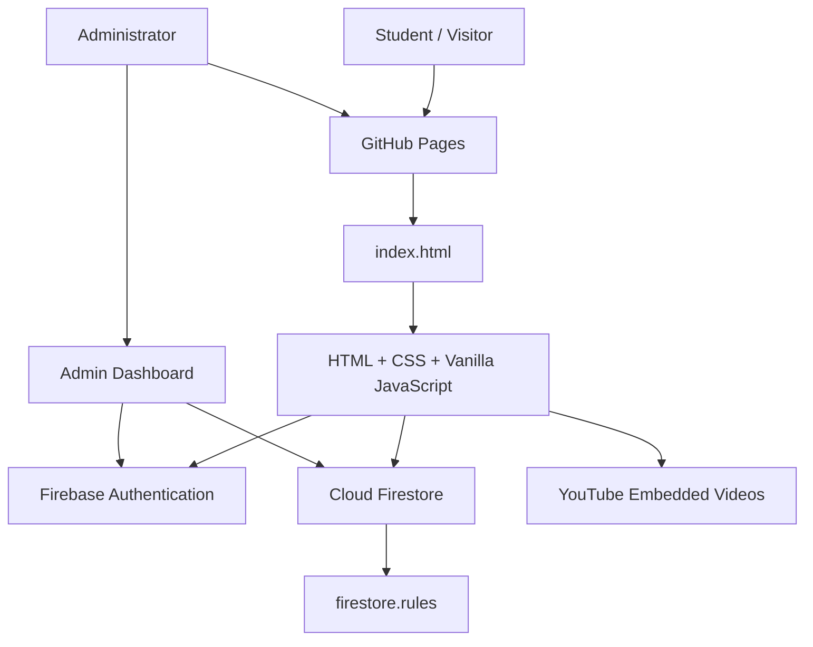

<!--
  The Leader — Project README
  English-first documentation with Arabic student-facing context.
-->

<div align="center">

# 👑 The Leader — English Learning Platform

### Learn English. Measure Progress. Celebrate Achievement.

**A student-focused digital learning platform built for The Leader English courses by Mohamed Fathy.**

[](https://theleadermo-en.github.io/)
[](https://github.com/theleadermo-en/theleadermo-en.github.io/stargazers)
[](https://github.com/theleadermo-en/theleadermo-en.github.io/commits/main)

**English-first documentation · توثيق عربي للطلاب والمنصة**

</div>

---

## ✨ Overview

**The Leader** is an interactive English-learning platform designed to make learning more organized, measurable, and engaging. It brings course information, level assessment, quizzes, exams, student progress, learning videos, and course booking into one accessible experience.

The platform serves preparatory and secondary students, while providing the teaching team with an administrative dashboard to manage learning content and monitor student activity.

> **The idea:** learning should not stop at watching a lesson. Students should be able to practise, assess their understanding, track their progress, and celebrate every improvement.

🌐 **Live platform:** [theleadermo-en.github.io](https://theleadermo-en.github.io/)

## 🎓 تجربة الطالب | The Student Experience

المنصة مش مجرد صفحة تعريفية بمدرس؛ دي مساحة تعليمية بتجمع أدوات تساعد الطالب يتعلم ويتابع مستواه في مكان واحد.

### 1. English Level Assessment

- A 40-question English placement test covering Grammar, Vocabulary, Reading, and Usage & Context.
- Questions progress across the **CEFR levels (A1–C2)**.
- A timed question flow with a 30-second limit per question.
- A final result with accuracy, correct and incorrect answers, average response time, and a skill breakdown.
- A shareable result summary.

**بالعربي:** الطالب يقدر يكتشف مستواه في اللغة من خلال اختبار تفاعلي، ويشوف تقرير يوضح أداءه في المهارات المختلفة بدل ما يعتمد على التخمين.

### 2. Interactive Language Quizzes

- Grade-oriented challenges for preparatory and secondary students.
- Short quiz rounds with instant feedback.
- XP points and completion celebrations.
- A progression flow that encourages consistent practice.

**بالعربي:** تحديات قصيرة ومناسبة للصف الدراسي، فيها نقاط وتجربة تنافسية تشجع الطالب يراجع ويتدرب باستمرار.

### 3. Exams & Results

- Online exams with multiple-choice questions.
- Configurable exam duration and question sets.
- Support for text-based and image-based questions.
- Results, scores, and incorrect-answer review.
- Students can access their own exam history through their account.
- Guest/anonymous authentication is used to allow visitors to enter the exam flow without creating a permanent platform account.

### 4. Learning Videos

- Educational video sections organized by school stage.
- YouTube video playback.
- Protected video access using an unlock-code flow.
- Video content can be managed from the administration interface.

### 5. Student Account & Progress

Registered students can use a personal account to follow their learning activity, including:

- Points and earned rewards.
- Level-test and quiz activity.
- Exam grades and previous results.
- Available learning files and materials.
- Personal learning progress.

### 6. Course Booking & Contact

Students can submit booking information based on their school stage, grade, preferred schedule, learning needs, and suitable learning location. The platform also provides direct contact options for course enquiries.

---

## 🛠️ Administration Dashboard

The platform includes a dedicated dashboard for authorized administrators. It is designed to keep routine teaching operations in one place.

| Module | Capabilities |
|---|---|
| Overview | Student statistics, points, activity summaries, and leaderboards |
| Students | Search, sort, inspect student profiles, adjust points, and grant rewards |
| Videos | Add, edit, organize, and manage learning videos and access codes |
| Exams | Create exams, configure settings, and manage question banks |
| Results | Review student results, sort grades, and export data |
| Top Students | Manage the public achievers section |
| Data Tools | Export student data to CSV and back up video data as JSON |
| Admin Access | Manage authorized administrators |

**ملاحظة:** صلاحيات لوحة التحكم مخصصة للمشرفين المصرح لهم، وليست جزءًا من تجربة الطالب العادية.

---

## 🧱 Technology Stack

The project intentionally uses a lightweight, browser-native frontend with Firebase services for authentication and cloud data.

| Layer | Technology | Purpose |
|---|---|---|
| Structure | HTML5 | Page structure and semantic content |
| Styling | CSS3 | Responsive layouts, visual system, transitions, and animations |
| Application Logic | Vanilla JavaScript (ES6+) | UI interactions, quiz flows, exams, dashboard logic, and client-side state |
| Authentication | Firebase Authentication 10.12.2 | Email/password, Google sign-in, and anonymous sessions |
| Database | Cloud Firestore | Student profiles, exams, questions, results, and top students |
| Authorization | Firestore Security Rules | Document-level access control for students and administrators |
| Video | YouTube Embed | Educational video playback |
| Typography | Google Fonts | Cairo and IBM Plex Sans Arabic |
| Hosting | GitHub Pages | Static website hosting and deployment |

### Architecture Notes

- The frontend is a **static, single-page application** served from the repository.
- The main application markup, styles, and JavaScript are currently maintained in `index.html`.
- Firebase is loaded through its browser-compatible CDN SDK (version `10.12.2`).
- Firestore is the cloud data layer; there is no separate Node.js/Express application in the current repository structure.
- Small browser-specific preferences and video-attempt counters use `localStorage`.
- YouTube provides the embedded video player and thumbnail images.

### High-Level Architecture



---

## 🗂️ Project Structure

The current repository follows a compact, root-level structure rather than a multi-package frontend/backend layout.

```text
theleadermo-en.github.io/
│
├── index.html       # Main application: HTML, embedded CSS, and JavaScript
├── firestore.rules  # Firestore database security and access rules
├── favicon.svg      # Browser favicon
└── README.md        # Project documentation
```

### Important Files

- **`index.html`** — Contains the public website, student-facing experiences, authentication UI, exams, quizzes, account area, and admin dashboard.
- **`firestore.rules`** — Defines who can read or write the platform's Firestore documents.
- **`favicon.svg`** — The platform's SVG browser icon.
- **`README.md`** — Technical and product documentation.

> The current implementation is intentionally centralized in one main HTML file. The structure above documents the verified core files; it does not imply that the application is split into separate frontend and backend packages.

---

## 🔐 Authentication & Data Security

Firebase Authentication and Firestore Security Rules work together to separate student access from administrator operations.

### Authentication Methods

- Email and password registration/login.
- Google sign-in.
- Anonymous Firebase sessions for the guest exam experience.
- Account-aware UI for student and administrator features.

### Firestore Collections

| Collection | Purpose |
|---|---|
| `admins` | Authorized administrator records |
| `students` | Student profiles, points, rewards, and activity |
| `exams` | Exam metadata and configuration |
| `exams/{examId}/questions` | Questions belonging to an exam |
| `examResults` | Submitted exam results |
| `topStudents` | Public achiever/leaderboard entries |

### Security Rules Summary

- Administrator status requires a verified signed-in account with a matching record in `admins`.
- Students can access their own profile; administrators can access student records for management.
- Exam and question management is restricted to administrators.
- Students can submit results associated with their own authenticated UID.
- The public top-students section is readable by visitors, while write operations are restricted to administrators.

**Security reminder:** Firebase client configuration is not a substitute for access control. Keep Firestore Security Rules deployed and reviewed, configure Firebase Authentication's authorized domains, and never place service-account credentials or private server secrets in browser code.

---

## 🚀 Getting Started

Because the current frontend is static HTML/CSS/JavaScript, there is no npm installation or frontend build step required.

### Prerequisites

- A modern web browser.
- A local static web server (recommended for development).
- A Firebase project if you need authentication and cloud-backed features.

### 1. Clone the Repository

```bash
git clone https://github.com/theleadermo-en/theleadermo-en.github.io.git
cd theleadermo-en.github.io
```

### 2. Run the Website Locally

Using Python:

```bash
python -m http.server 8000
```

Then open:

```text
http://localhost:8000
```

You can also use the Live Server extension in Visual Studio Code.

### 3. Configure Firebase

The application initializes Firebase in `index.html`.

To run the cloud-backed features in your own environment:

1. Create or select a Firebase project.
2. Enable the authentication providers used by the application: Email/Password, Google, and Anonymous.
3. Create a Cloud Firestore database.
4. Configure the required authorized domains in Firebase Authentication.
5. Review and deploy the rules from `firestore.rules`.
6. Ensure the application is connected to the intended Firebase project before testing real student data.

**Important:** Do not replace production Firebase settings or test against real student records without authorization. Use a separate development Firebase project for experiments.

### 4. Deploy with GitHub Pages

1. Open the repository's **Settings → Pages**.
2. Select the `main` branch and the repository root as the publishing source.
3. Save the configuration.
4. Wait for GitHub Pages to publish the site.

The live website is available at:

[https://theleadermo-en.github.io/](https://theleadermo-en.github.io/)

---

## 🧭 Platform Flow

```text
Visitor
  │
  ├── Explore courses and platform information
  ├── Take the English level assessment
  ├── Try available language challenges
  ├── Enter the exam flow
  └── Register / Sign in
          │
          ├── Student Account
          │     ├── Track progress
          │     ├── Review exam results
          │     ├── Collect points and rewards
          │     └── Access learning content
          │
          └── Authorized Administrator
                ├── Manage students
                ├── Manage videos
                ├── Create exams and questions
                ├── Review results
                └── Manage top students
```

## 🤝 Contributing

Contributions, bug reports, and thoughtful suggestions are welcome.

If you would like to improve the platform:

1. Open an issue describing the problem or proposed improvement.
2. Keep changes focused and easy to review.
3. Test student and administrator flows affected by your changes.
4. Submit a pull request with a clear description of the changes.

Please avoid including private student information, credentials, or production configuration in issues and pull requests.

## ⭐ Support the Project

If you find this project interesting, useful, or inspiring:

- Give the repository a **Star** ⭐
- Share the live platform with someone who may benefit from it.
- Report bugs or suggest improvements.
- Help make educational technology more accessible.

A GitHub Star is a small action that helps the project gain visibility and reach more developers.

<div align="center">

### If you believe in better learning experiences, support The Leader with a ⭐

[](https://github.com/theleadermo-en/theleadermo-en.github.io)

</div>

---

## 👨‍🏫 About The Leader

**The Leader — Mohamed Fathy** is an English-learning platform focused on preparatory and secondary education. Its goal is to make English learning clearer, more structured, and more engaging through lessons, practice, assessment, and student follow-up.

## 👨‍💻 Design & Development

The platform credits **Creatix Studio**, led by **Obaida Mohy (عبيدة محي)**, for its design and development.

The project combines product design, frontend implementation, Firebase integration, and student-centered learning workflows into one cohesive platform.

---

## 📌 Project Notes

- **Project type:** Educational web platform
- **Primary audience:** Preparatory and secondary students
- **Frontend:** HTML, CSS, Vanilla JavaScript
- **Cloud services:** Firebase Authentication and Cloud Firestore
- **Hosting:** GitHub Pages
- **Main entry point:** `index.html`

---

<div align="center">

**Built to make learning English clearer, smarter, and more engaging.**

**صُممت المنصة علشان تخلي رحلة تعلم الإنجليزي أوضح وأسهل وأكثر تفاعلاً.**

[Live Website](https://theleadermo-en.github.io/) · [Repository](https://github.com/theleadermo-en/theleadermo-en.github.io)

</div>
